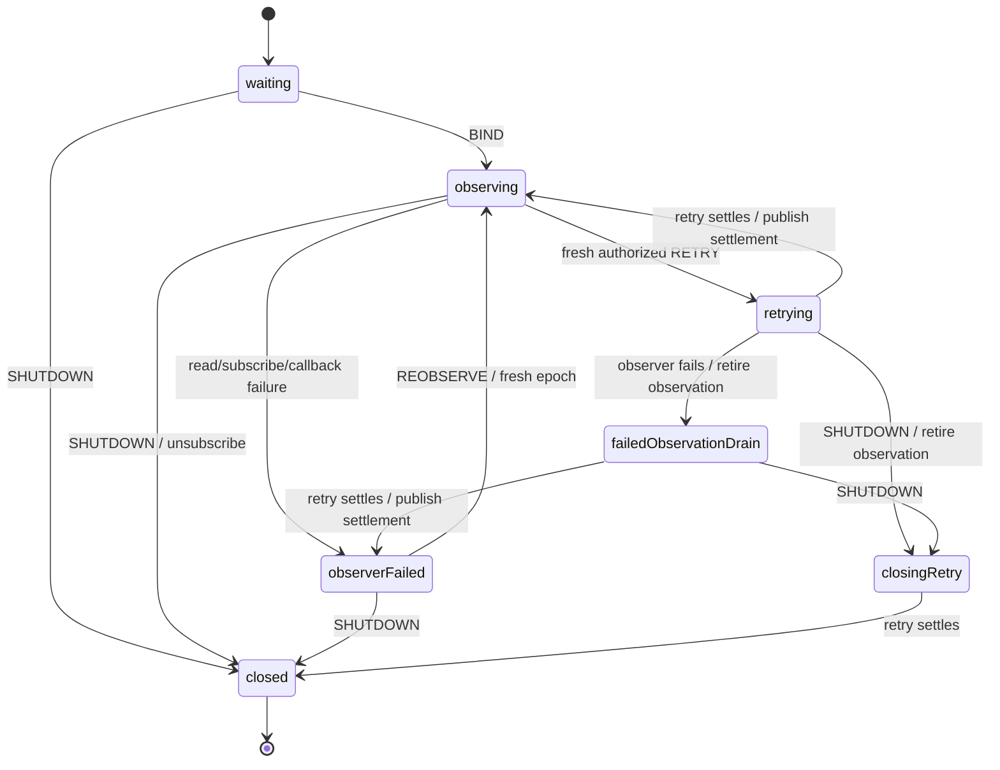

# Acquired session readiness and retry

Status: library implementation/coverage and Finance adoption merged in library PR #4 and Finance
PR #39, at `9372e0a` and `f83be67`. The design below records the reviewed boundary; initial baseline
observations and implementation review notes are historical. See the completion record at the end.
The next proposed slice is [workspace lifecycle](../workspaces/plan.md).

## Scope and evidence

Recovery reveal, identity restoration, and startup acquisition/attachment are merged and verified
in Finance. Acquisition returns a session reference; it does not establish account/client readiness.
The next increment extracts the acquired session's observation and explicit SDK retry lifecycle.
Finance retains workspace/transfer draining, domain mutation rejection handling, restoration,
route navigation, and application presentation. Workspace migration is a later slice.

Finance's `application-readiness.ts` currently invokes an SDK status subscription and one retry
promise. Its preparingRetry state drains the workspace before issuing retry; retrying keeps that
invocation alive across observer/startup failure and shutdown. The existing restoration subtree
similarly retains issued identity mutation. These guarantees must survive extraction.

Installed `jazz-tools@2.0.0-alpha.59`, `dist/session/state.d.ts`, exposes getSnapshot(), subscribe()
returning an unsubscribe function, and retry(): Promise<void>, with statuses ready, signed-out,
transitioning, error, and closed. A ready snapshot is distinct from retry promise settlement.
The public API supplies no retry cancellation argument. No raw snapshot/error/account/client is
needed by the reusable workflow. No SDK upgrade or new persistence/authorization claim is proposed.

## Ownership and integration

```text
Browser host → existing acquisition owner → retained Jazz session
Finance application root
├─ existing startup attachment
├─ library acquired-session readiness actor
│  ├─ one observation subscription (via supplied integration capability)
│  └─ at most one issued retry leaf, retained until settlement
├─ existing workspace / transfer owners and rejection observer
└─ existing restoration / navigation subtree
```

The readiness actor is application-owned, not another browser singleton or acquisition owner.
Invoke it at the application root, initially waiting without a binding. On acquisition the parent
supplies a fixed binding built by the layout-owned integration factory. This lets it remain alive
through parent failure/drain states without changing every existing parent state into a new tree.
Root restart creates a fresh readiness attachment. Repeated BIND does not replace an active binding.
It never closes/logs out the SDK session or stops the acquisition owner.

The layout supplies a Jazz adapter factory, following the existing restoration binding seam.
The adapter binds getSnapshot/subscribe/retry to the already acquired session. The workflow invokes
one callback actor to own subscription acquisition/release; the integration capability performs
SDK calls and normalizes facts. No Jazz subscription enters pure presentation or generic policy.
Finance keeps its mutation rejection subscription and all account/client-specific data binding.

## Public boundary (provisional names)

Use actor-free contracts in `session/contracts`, workflow factories in `session/workflow`, and
an optional Jazz adapter under `backend/jazz/session-readiness`. Keep existing startup exports intact.

A binding contains a non-secret identity token and capability with synchronous readStatus(),
subscribe(notify) returning unsubscribe, and retry(): Promise<void>. Status is the finite union
ready | signed-out | transitioning | error | closed, not a Jazz snapshot. Binding construction is
lazy and performs no SDK read, subscription, retry, or acquisition.

Each attachment carries a fresh token; observation subscription and retry attempts have separate
monotonic generations. Reports/commands include binding, attachment, and the relevant generation.
Do not reuse startup acquisition generation as a retry/observation epoch. Repeated status values
are facts, not proof that an issued retry has completed. Parent guards reject foreign/stale scopes.

Commands and reports:

- BIND supplies the fixed scope/capability once, after startup acquisition.
- SESSION_STATUS reports a normalized status with observation generation. It describes the SDK,
  not workspace eligibility. SESSION_OBSERVATION_FAILED reports a finite reason, no raw error.
- RETRY supplies a fresh attempt after Finance's pre-drain. This command is the parent's explicit
  authorization that its scoped work has drained and no restoration operation is active. Only the
  application coordinator sends it. Duplicate/obsolete attempts and retries while issuing are ignored.
- SESSION_RETRY_STARTED and SESSION_RETRY_SETTLED identify the exact attempt. Settlement distinguishes
  resolved and rejected; resolution alone never publishes ready. Reports include no SDK error.
- REOBSERVE starts a fresh observation generation after the parent has drained following observer
  failure. It does not call session.retry or recreate the SDK session. Reject it during issued retry.
- SHUTDOWN prevents further starts/retries, releases observation, and waits for issued retry before
  completing with output closed. Finite output belongs to invocation completion, not status reports.

Exact exported types/names are to be settled with implementation; this is a protocol design, not
an already shipped API. Capabilities and session references stay outside diagnostic serialization.

## Statechart and interruption



The retry invocation lives on a compound state encompassing retrying, failedObservationDrain, and
closingRetry. Implement those as nested phases, not sibling states that cancel/reissue the promise.
Observation has its own explicit lifetime and can be released without stopping retry. All invoked
children have onError paths. A synchronous retry throw is a rejected attempt. Observer setup and
callback failures enter explicit failure paths; unsubscribe exceptions are sanitized and cannot
prevent retry retention or terminal cleanup. Call cleanup at most once per acquired subscription.

Keep an already delivered SDK status as an observed fact, never a mirrored lifecycle flag. A retry
rejection produces explicit failed feedback even if the SDK emits no error snapshot. A retry success
requires a current observation before readiness is reported; do not reuse a pre-retry ready fact.
After successful settlement, perform one guarded status read through the existing observation
boundary (or its correlated refresh command), without waiting for remote data or another notification.
If that read fails, report observer failure, not retry rejection. On shutdown do not reacquire or
refresh an observer merely to publish readiness. Failure reports arriving while closing cannot
reverse shutdown. Duplicate shutdowns are idempotent.

Startup-owner failure remains a parent concern: the parent requests readiness shutdown, drains its
workspace, and waits for both before releasing startup. The library does not recreate an uncertain
owner. A child crash is distinct from ordinary retry rejection: a crashed actor cannot prove its
issued SDK call was cancelled. Parent fallback must expose failure and must not automatically
reissue retry or restoration. Unexpected interruption guarantees cover modeled child errors, not
external actor.stop(), page termination, or uncoordinated SDK calls.

## Finance coordination

Preserve the existing sequence, rather than moving Finance policy into the library:

1. Finance receives user Retry, disables competing restoration/attachment work, and drains its
   current workspace. Status notifications during this pre-drain cannot cancel the pending intent.
2. Only after the matching workspace closure does Finance send the authorized RETRY attempt.
3. During issued retry, Finance retains that child and ignores repeated user mutation intents.
   It may retain normalized status facts but cannot reattach a workspace based on ready alone.
4. On settlement, Finance advances its existing attachment revision even if the SDK client object
   is unchanged. Rejection yields existing generic failure feedback. Resolution uses the refreshed
   status; no new account, workspace, or navigation is inferred.
5. Shutdown wins over startup failure, which wins over observation failure, which wins over normal
   retry completion. Finance waits for the issued retry and workspace cleanup before leaving the
   session scope. Never await completion from a confirmed failed/completed child.

Restoration remains mutually exclusive through the existing application coordinator. The library
observer may receive status while restoration runs; Finance's restoration states retain ownership
of when reattachment is permitted. Observation failure during restoration triggers the existing
restoration drain/settlement path and cannot discard an issued restore or navigate again. A recovery
navigation retry continues to retry navigation only. An observer recovery uses REOBSERVE after drain,
not SDK retry. Initial acquisition retry remains the startup attachment's separate command.

SESSION_STATUS is not authority for workspace permissions, remote freshness, persistence, identity
replacement, or replica completeness. Keep the existing JazzSessionProvider and domain subscriptions.
No new UI, CSS, localized copy, schema, data migration, or remote readiness gate belongs here.

## Delivery and review

First review this ownership/protocol design. Then implement library contracts, workflow, Jazz leaf
adapter, and exports as one focused runtime review (roughly four implementation files). Present its
recursive machine-first audit before adding/running implementation tests. After approved coverage
and package checks, review Finance adoption separately: layout binding, application coordination,
and one vendored snapshot/package update. Discuss the file batch before editing. Remove superseded
runtime paths and migrate their fixtures with replacement coverage after implementation approval.

Affected verification to prepare, not execute in this design cycle:

- Library real-actor cases: all normalized statuses; subscription/read/callback/setup/cleanup failure;
  stale observation and retry scopes; duplicate commands; retry resolve/reject without notification;
  late ready during retry; fresh read after settlement; observer failure plus each retry outcome;
  shutdown before bind, before issue, during retry, after observer failure; one unsubscribe; no SDK close.
- Backend tests: exact supplied session reuse, no acquisition, lazy binding, one retry leaf, finite
  status projection, sanitized failures, physical shared SDK instance, SSR without binding/effects.
- Built public consumer imports and synthetic attach/retry/shutdown, type/lint/format/package/publint.
- Finance `application-readiness.test.ts`: pre-drain interruptions, issued retry retention, priority,
  same-client revision, workspace closure correlation, observer failure during restoration,
  startup-owner failure, navigation-only retry, and parent/child crash handling.
- Finance authentication startup/restore/session retry regressions; debugging flag on/off diagnostic
  fixture; existing production cold unanswered-server and offline read/save cases. Inspect all affected
  fixtures before execution; keep credential artifact protection and disposable agent environments.

No tests or services have been started for this implementation review. Runtime qualification applies
only after implementation review and approved execution; previous startup checks do not prove this slice.

## Initial implementation review

The focused runtime batch is five files: existing session contracts, the session workflow barrel,
the new readiness machine, the new Jazz adapter, and package exports. Existing startup/recovery
exports are unchanged. The library branch remains `plan/shared-session-readiness`; Finance's fresh
planning branch has no changes.

Public names now follow the protocol above: createSessionReadinessMachine(),
createJazzSessionReadinessAdapter(), SessionReadinessEvent/Input/Report/Binding/Capability/Scope.
Binding starts observation epoch zero; positive safe integer retry attempts and reobservation epochs
must increase independently. BIND copies the scope and is accepted only while waiting. RETRY is
accepted only in observing or retryFailed, after the host's drain authorization. REOBSERVE is accepted
only following observer failure; it reenters the bound lifetime with a new observation epoch.

SESSION_RETRY_SETTLED reports mutation settlement only. On resolution, a distinct refreshing state
requests one synchronous status read from the existing observer. The resulting SESSION_STATUS has
afterRetry equal to the attempt. The host must wait for that current status (or observer failure)
before resuming work; it must not interpret settlement or a status seen during retry as readiness.
On rejection, retryFailed preserves an explicit failure phase and permits another fresh attempt.
Status notifications may continue there as SDK facts; they do not erase the rejected outcome.

The retry invocation encloses active, observerFailed, and closing phases. No transition among these
phases cancels the issued promise. Shutdown unsubscribes promptly, suppresses late observation reports,
retains the retry until resolution/rejection, and performs no post-settlement refresh. Observer failure
before or during retry retires the subscription; reobservation does not issue an SDK retry. A normal
shutdown clears binding/capability references. SESSION_OBSERVATION_CLEANUP_FAILED is a separate finite
resource report; a throwing unsubscribe does not stop settlement or terminal cleanup. It cannot
prove that an SDK subscription which throws on release physically detached.

Recursive machine-first audit:

- The machine owns waiting/binding, accepted command phases, monotonic correlation, observation
  failure, retry failure, refreshing, issued-retry retention, shutdown, and terminal cleanup.
- The callback actor acquires one subscription, reads normalized status at notifications/refresh,
  and returns one unsubscribe. Its active guard suppresses callbacks after read/setup failure or
  cleanup; it is a narrow resource guard, not a duplicate readiness/retry lifecycle. Catch boundaries
  classify only read, subscribe, and release errors; they never log raw exceptions or retry operations.
  A subscribe implementation that acquires resources and throws without returning cleanup remains
  the integration's responsibility; the workflow has no handle with which to invent cleanup.
- The promise actor delegates exactly one supplied retry() call, with onDone/onError on its owning
  compound state. Unexpected observer actor errors follow the same retention path as observation
  failure. No manual actor-start/await bridge, promise cache, remote preflight, or nested orchestration
  was added.
- The Jazz adapter performs only lazy binding of getSnapshot().status, subscribe(), and retry() on
  the supplied session. It owns no session creation, credential handling, workspace, or session close.

Static type checks pass with zero Svelte errors/warnings. Focused lint/format, diff checks, package build, and strict publint pass; built declarations
include the new workflow and adapter exports. No unit tests, browser tests, or new consumer fixtures have been added
or executed. The affected test inventory above is the next review gate; Finance adoption follows
only after the library behavior and package boundary have approved coverage.

## Approved library verification

The user approved implementation and authorized its commit and coverage on the next review cycle.
All 33 focused cases pass: 25 readiness workflow cases and eight Jazz adapter cases. Real XState
actors exercise waiting/SSR-safe no effects, five statuses, binding/epoch correlation, duplicate and
invalid retry attempts, stale callbacks, read/setup/synchronous-notification failures, reobservation,
cleanup exceptions, resolved/rejected/synchronously throwing retries, fresh status reads without SDK
notifications, observation failure during retry, and shutdown priority for both retry outcomes.
Observer crash routing during issued retry is covered using injected XState error events; this is
not evidence that arbitrary external actor termination cancels SDK work. The only production-source
adjustment in this coverage cycle adds the framework observer-error variant to the internal event
type so those existing error transitions can be exercised without casts. No runtime policy changed.

The Jazz adapter cases use a typed supplied session stub, not a live server. They verify lazy binding,
exact subscription/cleanup forwarding, all five status projections, and one retry call without
automatic retry, session creation, close, or logout. They do not qualify the SDK's actual mutation
or storage behavior; that remains part of Finance adoption verification.

The built-package consumer resolves the new public declarations and runtime entries, performs a
synthetic bind → retry → refreshed observation → shutdown through the real packaged adapter, and
checks one retry and one subscription release. NodeNext declaration checks, Node runtime import,
and Vite consumer build pass. Full source types, package build/strict publint, focused lint/format,
and diff checks pass. No browser server, credential, schema, archive, or Finance runtime was changed.

Next: review this coverage change, then pack the library and propose the focused Finance adoption
batch described above. Startup acquisition and restoration remain separate and unchanged.

## Merged adoption completion

Finance adoption and verification are merged. Its 68 focused unit cases, 11 authentication cases,
two production cold/offline cases, and debug on/off startup diagnostics pass, with standard source
and browser-test type checks. Finance retains its session provider, domain schema, workspace cleanup,
restoration, and navigation; the library owns acquired-session observation and issued retry. The
transfer fixture follow-up `75b7376` passed three two-worker runs while checking conflict updates in
the active workspace. No new session-disposal or general crash-cancellation guarantee was established.
