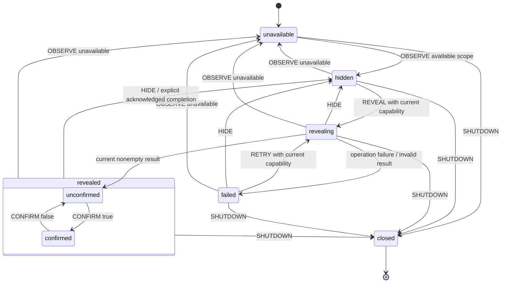

# Recovery Slice: Transient Model and Statechart

**Status**: Proposed design. No persisted schema or migration.

## Data Ownership

| Entity              | Fields / constraints                                                                        | Owner / lifetime                                                                        |
| ------------------- | ------------------------------------------------------------------------------------------- | --------------------------------------------------------------------------------------- |
| Recovery scope      | `unavailable`, or `available` with identity ID, opaque dependency binding, generation       | Host integration publishes current scope; contains no Jazz handle or credential         |
| Dependency binding  | Non-secret token stable for one attached adapter/session environment                        | Replaced on host-session/environment/adapter replacement; prevents old generation reuse |
| Generation          | Monotonically advances on account-handle replacement, including same user and A → B → A     | Integration binding owner; not recreated by ordinary render or locale change            |
| Recovery capability | Read phrase for a captured available scope; no session lifecycle commands                   | Jazz adapter closure retains current handle access and releases references on detach    |
| Phrase              | Nonempty returned string; never persisted or included in public diagnostic reports          | Invocation then recovery context only while revealed; exposed to the view for display   |
| Acknowledgement     | Confirmed/unconfirmed substate, reset after hide/scope change/failure                       | Recovery machine; no durable claim of backup or successful restoration                  |
| View model          | Unavailable, hidden, revealing, failed, revealed with phrase and acknowledgement, or closed | Pure projection; secret-bearing variants must not be retained for history/debug         |
| Recovery messages   | Complete resolved strings for all rendered labels/instructions/feedback                     | Presentation inputs; locale changes update text without changing workflow state         |

Unsupported issuer/credential availability is a local capability limitation, not evidence of an
invalid identity. Adapter failures expose a finite sanitized category, never raw error messages,
account handles, root secrets, or SDK output. Only available scope can start a reveal. Every retry
re-evaluates the same condition and the leaf rechecks the live binding at export time.

## Statechart



Initial state is selected from the initial scope (hidden if available). Diagram shows the unavailable
initial case. Replacement by a different available scope from **any nonterminal state** clears phrase
and acknowledgement, cancels the old invoke, and enters hidden with the new binding/generation.
Repeated equal observations do not reset a revealed interaction. Late prior-scope completions never
publish a view. Scope invalidation has priority over completion/retry; recheck current scope before
publishing a result even if host observation delivery and promise settlement are adjacent.

The revealing invocation is a leaf, not a nested workflow. Jazz conversion has no transaction,
remote settlement, acquired resource, or meaningful partial success. A rejected reveal enters failed;
an interrupted one clears into hidden/unavailable; closed is terminal shutdown. Confirmed display is
not proof that the user actually stored a backup. No fictitious partial-success state is added to a
single local conversion. Multi-step restoration and its success/failure model belong to another slice.

## Events and Results

User events: REVEAL, RETRY, CONFIRM(value), HIDE. Integration events: OBSERVE(scope), SHUTDOWN.
Commands never carry phrase text. Invocation completion is private and contains the phrase only until
it is assigned/discarded. Public callbacks, if needed, report only dismissed/acknowledged/unavailable
or sanitized failure; do not emit phrase, raw snapshots, or a durable backup-complete event.

## Actor and Resource Ownership

```text
Finance session/workspace owners (unchanged)
└─ Finance account recovery host binding
   ├─ existing session observation → typed scope/capability
   └─ library RecoveryPhrase integration
      └─ recovery machine
         └─ invoked local reveal leaf (only in revealing)
```

The Jazz adapter supplies the leaf; it does not own a client or create a subscription. Finance owns
the SDK observation and forwards its current state. The library integration owns the actor and its
view subscription. It begins client-side, defaults to no-secret SSR output, and sends SHUTDOWN to
clear state before unsubscribing/stopping on teardown. The resource-free leaf requires no remote
drain acknowledgement. Do not impose this immediate cleanup protocol on future resource-owning
session transitions without their own design.

On host invalidation, clear synchronously at the binding boundary and send OBSERVE before exposing
new identity controls. Do not depend solely on a delayed rendering effect to protect an already
revealed phrase. The host remains responsible for changes made through external SDK calls until
observed; the library does not claim interception of arbitrary identity changes.

JavaScript cannot revoke previously obtained strings, erase old caller snapshots, or reliably zero
memory. Clear owned references/DOM and avoid snapshot persistence; document that precise guarantee.
