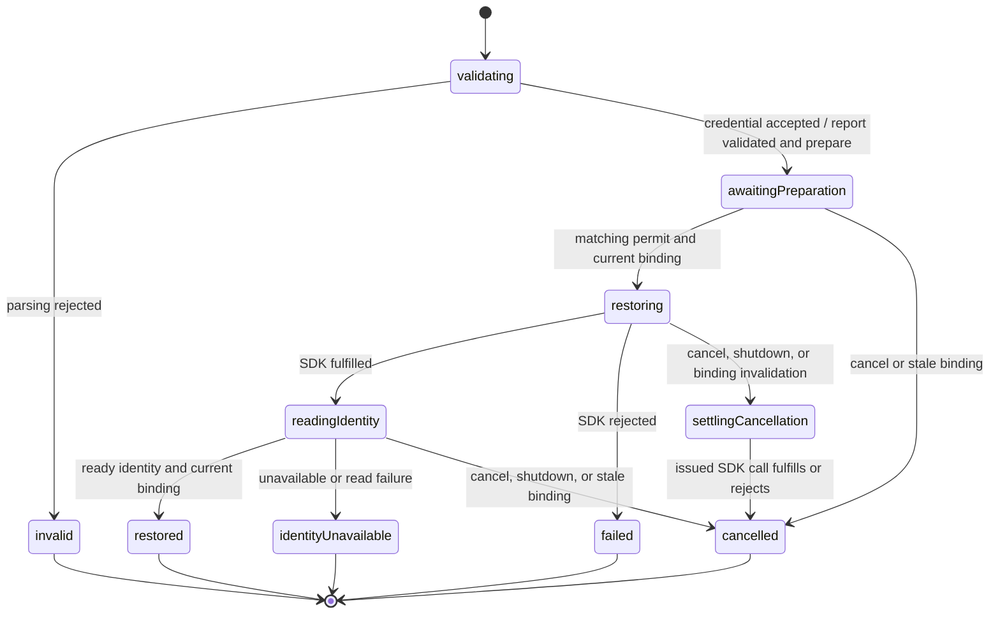

# Identity restoration: next incremental slice

Status: initial library implementation reviewed; 47 focused restoration tests and built-package
consumer checks pass. Finance adoption remains the next implementation review.
No new strings, dependency versions, or Finance runtime changes in this library cycle.
See [implementation notes](../../../docs/restoration-workflow.md).
Library branch: `feat/identity-restoration-plan`, based on library main `bde1c77`.
Finance branch: `feat/identity-restoration-main`, based on main `629bd82` after PR #35 merged.

## Outcome and scope

Extract phrase validation and the issued identity-restoration lifetime into a reusable child machine
and Jazz adapter. Finance keeps its application readiness root, workspace/bank/transfer drain,
startup/reattachment, navigation, login form, existing messages, and route. This first increment does
not require a new login component, session provider, startup framework, schema, or migration.

The completed reveal slice is the reference: library commits through `42d001c` are merged into
library main. Finance PR #35 consumes the packed library and passed local checks for disclosure,
cleanup, account replacement, profile saving, and cross-device restoration. Finance PR #35 is now merged. Its follow-up starts from fetched main; local verification evidence
remains distinct from CI results.

## Why a child, rather than a component-owned restore callback

Finance's existing `session-recovery.ts` coordinates validation, workspace draining, a non-abortable
SDK call, identity reading, and navigation. Its parent survives the login page and tracks issued
operations until settlement. Moving this into a login component would break that ownership.

The reusable responsibility is one sensitive restoration attempt. Navigation and workspace policy
remain host responsibilities; the host wrapper composes a fixed invoked library child. Do not move
Finance's entire application machine into the library or introduce a promise bridge to a manually
started child. No second lifecycle coordinator may issue the same identity-changing call.

```text
Finance application readiness (existing root)
├─ existing workspace/bank/transfer owners and their drain protocol
└─ Finance session-recovery wrapper (existing invoked attempt lifetime)
   ├─ library restoration child: validate → wait for permit → restore → read identity → finish
   └─ host navigation states: check current identity/URL → navigate → retry navigation only
```

The wrapper forwards the child's typed validation/drain notices to the application, then forwards
the application's matching permit to the child. It consumes finite output; it never inspects child
context or state paths. This is an explicit parent/child protocol, not an integration-component router.

## Proposed contracts (names provisional)

The workflow entry consumes actor-free contracts; only `backend/jazz/` imports Jazz. The adapter
binds to the host's existing session. It never creates/closes a session, selects an unrelated account,
subscribes, manages workspaces, or navigates. Proposed leaf capability operations:

| Operation                     | Contract and purpose                                                                                                                                            |
| ----------------------------- | --------------------------------------------------------------------------------------------------------------------------------------------------------------- |
| `parsePhrase(phrase)`         | One local SDK conversion; returns a sensitive credential string only to the child invocation. No preflight, repair, or mutation.                                |
| `isCurrentBinding(binding)`   | Total synchronous predicate over the fixed host session/environment binding. Account replacement by this attempt does not replace the session binding.          |
| `restoreIdentity(credential)` | Exactly one host-bound `restoreLocalFirst` call, including an adjacent repeat of the modeled binding check. Promise settlement is not cancellation or rollback. |
| `readIdentity()`              | One current host snapshot read, returning ready identity or unavailable; no remote discovery.                                                                   |

Credential encoding is backend-defined and deliberately not a portable identity/schema format.
Prepared credentials are private to the child and SDK invocation, never parent reports or terminal
output. No adapter credential cache or hidden read/check/write workflow is required.

Each attempt carries a non-secret fixed binding token and monotonically increasing attempt number.
The host serializes identity-changing commands for that session. The actor input includes the phrase,
capability, correlation, and typed report recipient. Input and snapshots are sensitive and must never
be inspected, persisted, logged, or retained for debugging. Later commands use typed events:

- Child reports `VALIDATED` and `PREPARE_REQUESTED` with binding and attempt only.
- Host replies `PREPARED` only after its actual resource owners finish their existing cleanup.
- `CANCEL` and `SHUTDOWN` request interruption; binding invalidation prevents unissued mutation.
- Terminal output includes correlation, finite outcome, mutation fact (`notStarted` or `settled`),
  and restored identity only on successful identity observation. No phrase, credential, or raw error.

Ignore foreign/stale preparation replies. A permit is accepted only while awaiting preparation;
a duplicate cannot repeat restoration. Parent notices/replies must correlate the whole binding and
attempt, not just identity ID. Session/environment replacement starts a new binding. The host must
keep an issued old binding alive until its attempt settles, even after its view disappears.

## Statechart and interruption



`restoring` and `settlingCancellation` must be substates of one invocation-owning compound state;
transitioning between them retains the same SDK promise. Cancellation during validation/preparation
finishes without mutation; shutdown has the same priority. All terminal states clear private phrase
and credential context references; caller-held input and SDK invocation input cannot be erased. Clear the parent's raw phrase on validation acknowledgement; Finance's
existing invalid-draft behavior remains unchanged. Clear the child's phrase once parsing settles;
release its credential reference once invocation input is bound, following the current reviewed
Finance microstep pattern. The SDK invocation may retain its argument until it settles.

The child must not stop on route unmount. After issuing restoration, cancellation suppresses success
presentation/navigation but waits for SDK settlement. Output still reports the settled mutation fact
so the application can re-observe/reattach resources. A rejected SDK call does not prove unchanged
identity or rollback; host readiness observes the actual session. `identityUnavailable` is partial
completion (mutation settled, usable identity unconfirmed), never success or an automatic retry.
Every invoked leaf has a sanitized error path; child crashes follow the parent's settlement/error
protocol without awaiting acknowledgements from an already dead child.

The current SDK does not provide causal tags for arbitrary external identity changes. Expected
session/account changes during this issued restore are not treated as an unrelated attempt. The
host's serialization and binding protocol provide this guarantee for coordinated calls only. Do not
claim to intercept external SDK mutations, erase caller-retained strings, or abort issued SDK work.

## Preserve Finance behavior

The wrapper keeps origin/destination and existing navigation retry metadata. On successful library
output it checks current identity, session readiness, and origin URL using its existing states before
navigation. A changed route suppresses automatic navigation. Navigation rejection retains only
non-secret retry metadata; retry repeats navigation checks and never the identity mutation.

The application keeps attempt sequencing, validates reports, drains its existing workspace subtree,
and reattaches according to actual settlement. Keep observer/startup failure and shutdown priority,
same-client failure recovery, duplicate command rejection, and unrelated operation cleanup intact.
The login form and all Finance catalogs remain unchanged in the first adoption batch. Cross-app
credential authority disclosure remains required before any later cross-app reuse UI; this slice
only preserves Finance's existing explicit restore interaction.

## Delivery boundaries

1. Review this design; implement the actor-free contracts, child statechart, and Jazz leaf adapter.
   Inspect each actor/helper recursively before presenting. No new localization or UI in that batch.
2. After implementation approval, add focused library coverage and built-package adapter validation.
   Test valid/invalid input, stale permits/bindings, duplicate events, interrupted validation/drain,
   retained issued calls, both SDK outcomes after cancellation, partial identity observation, sanitized
   failures, and secret cleanup. Assert generated secrets using booleans only.
3. After library review, pack a new snapshot and replace Finance's validation/restore portion through
   its existing wrapper. Keep this PR based on `feat/library-recovery-adoption` until #35 merges.
   The first host batch should touch only the wrapper, readiness contract wiring if needed, dependency
   manifest/lock/archive, and focused notes. Discuss expansion before changing routes or components.
4. After host implementation approval, adapt affected unit fixtures before execution, then run only
   relevant authentication scenarios with protected artifacts and disposable agent storage. Create
   the stacked PR with #35's head branch as its base; retarget to main only after #35 merges.

Affected Finance coverage: application-readiness recovery scenarios (currently invalid draft,
matching drain, duplicate requests, interruption, same-client restore failure, navigation-only retry),
and authentication invalid input, cross-device restoration, restore failure, and navigation failure
scenarios. Inspect test doubles against the final protocol before adding/running tests.

Review gate: the initial library implementation and focused tests are complete; real Finance
session-lifecycle claims must come from the later approved host checks. Ordinary SDK/database operations and workspace migration
remain separate MVP slices.
