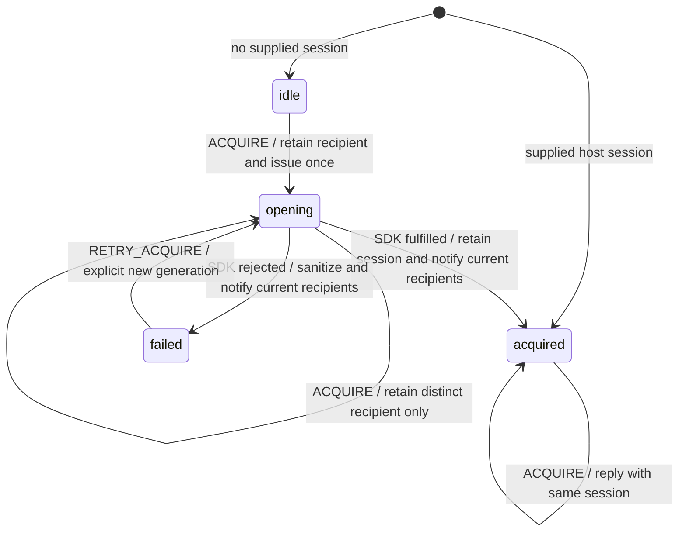
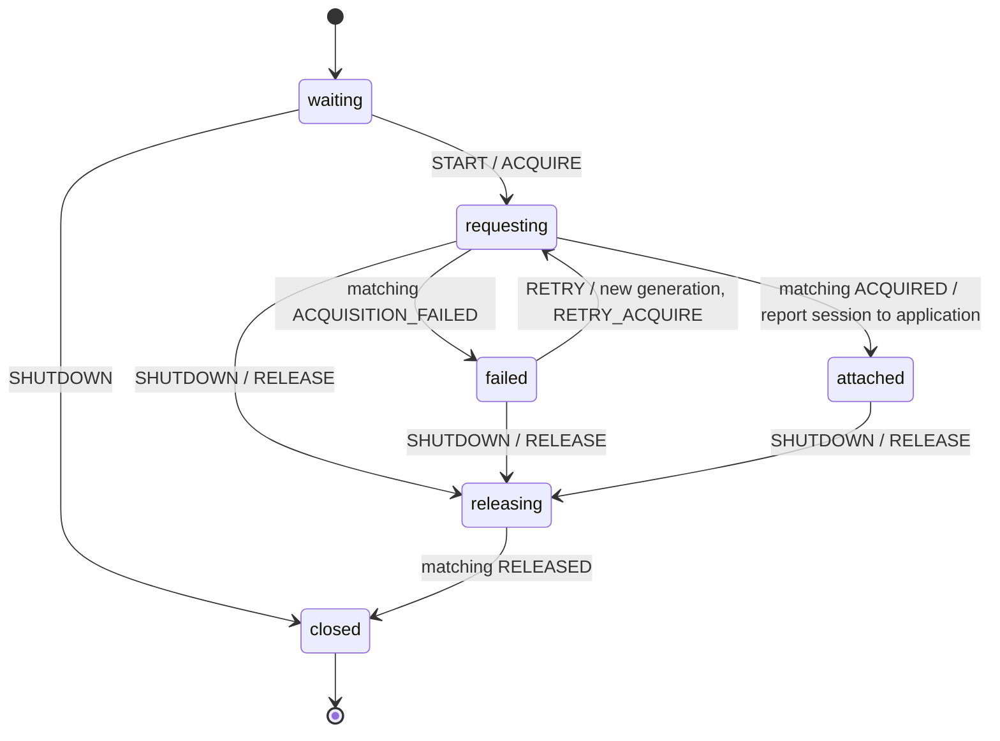

# Session startup and resume: ownership design

Status: initial library implementation committed as `a4518fb`; 31 focused tests pass.
Coverage and the observer-failure release fix await review. No new dependency versions, strings,
or Finance runtime changes.
See [implementation notes](../../../docs/session-startup.md).
Library branch: `plan/session-startup-resume`, from main `13ed26c`.
Finance branch: `plan/shared-session-startup`, from main `4905793`.
Recovery PRs (library #2 and Finance #37) are merged; their existing behavior is the regression baseline.

## Scope and meaning

A consumer can acquire its configured Jazz session once, attach/detach application lifetimes,
resume the same session reference, and explicitly retry failed acquisition. Acquiring a session is
not proof of a signed-in account, usable client, workspace authorization, replica completeness, or
remote freshness. Finance retains all those observations and decisions, workspace/bank/transfer
cleanup, restoration coordination, navigation, and presentation. No worker, seeding, query warming,
second backend, new account policy, or schema/data migration belongs in this slice.

This design separates **session acquisition ownership** from **an application's attachment**.
An SDK creation promise may settle after a layout disappears. Discarding its output or starting
another request on remount would lose ownership or create a second client.

## Evidence from current Finance

- `identity/session-startup.ts` models waiting → starting → ready/error. Its parent consumes private
  `onSnapshot` state/context; it has no shutdown protocol for pending acquisition.
- `runtime/jazz-session.ts` separately caches `sharedSession` and `sessionPromise` in module scope.
  It reuses pending work, publishes successful acquisition, and clears the promise after failure.
  These are meaningful acquisition decisions, not one leaf operation. Do not move that branching
  promise chain into a library promise actor and claim it satisfies the machine-first gate.
- The layout opens only after client mount and keeps JazzSessionProvider. Application shutdown drains
  workspaces and transfer mutations without closing the shared SDK session.
- Public Jazz alpha.59 `createJazzSession(config)` owns account-manager/client setup internally.
  It has no cancellation argument. Treat one call as the backend leaf; do not reconstruct private
  SDK internals or assume actor cancellation stops it.

## Ownership tree

```text
Browser host runtime (one explicit configured environment, no SSR singleton)
└─ library session-acquisition owner (host creates/retains this actor)
   └─ invoked public Jazz createJazzSession leaf, at most one at a time

Finance layout / application-readiness root
├─ invoked library startup attachment → direct typed relationship to that owner
├─ existing session observations and workspace/bank/transfer owners
└─ existing restoration wrapper and library restoration child
```

The two actors have independently meaningful lifetimes. The acquisition owner survives layout
unmount; the attachment follows application lifetime. This is one host-scoped owner, not a generic
registry, global event bus, or new provider. The host creates it only in the browser integration
boundary and supplies its direct actor reference. Core machines import neither Jazz nor Svelte.

The first adoption replaces Finance's cached pending/session control flow with that explicit owner.
Do not retain both caches and a new actor as competing acquisition owners. A minimal host module may
retain the owner reference and expose the current session through a documented public selector for
existing restoration adapters/tests; it must not start an actor at SSR module import or hide a second
state machine in promise callbacks. Config is fixed for this owner lifetime. Changing app/server/store
requires a separately coordinated environment replacement, not a string-keyed cache added here.

## Proposed actor-free facts and typed protocol

Contracts use generic `Session` payloads; SDK-native config/types stay in `backend/jazz/` and host
integration modules. Workflow entry points may define typed actor-recipient inputs. Proposed entries:
`session/contracts`, `session/workflow`, and `backend/jazz/session` (names provisional).

- Scope: non-secret environment binding + attachment token + monotonic request generation.
- Owner input: fixed binding, a single SDK `open` leaf, and optional already-owned session reference.
- Attachment input: typed application report recipient. Initial browser-only START supplies the
  direct owner reference and fixed scope; later START events cannot rebind an active attachment.
  This permits SSR waiting state without constructing a browser owner to satisfy actor input.
- `ACQUIRE` / `RETRY_ACQUIRE`: scope and reply recipient. The owner deduplicates matching requests;
  concurrent distinct attachments share one issued call. Retry is explicit, never a timer/loop.
- `ACQUIRED`: matching scope and opaque session reference. This is a private integration message,
  not a diagnostic or presentation payload; never serialize it or expose it in inspector history.
- `ACQUISITION_FAILED`: matching scope and a finite category, never raw SDK error/config/credentials.
- `RELEASE` → `RELEASED`: forget the matching attachment recipient before acknowledging detachment.
  The owner sends no new result after removing a recipient; a releasing attachment ignores any
  success/failure message already in transit.
- `START`, `RETRY`, `SHUTDOWN` are attachment commands. Initial START happens on browser mount.
  A retry advances request generation. START/RETRY while requesting cannot issue duplicate work.

Reports expose a selected public protocol; parents must stop matching the child's private state
paths/context. The session reference belongs only at integration boundaries. A pure startup view
gets finite presentation state and callbacks, not a Jazz session, SDK error, or actor snapshot.
There is no new UI or catalog in this first slice; Finance keeps existing startup messages.

## Acquisition-owner statechart



`RELEASE` is handled in every state by removing that matching recipient and acknowledging it. It
never cancels or restarts the SDK invocation. If every attachment releases during opening, the
owner still retains the issued call, caches its eventual session, and serves that same session on a
later attachment. No result is orphaned and no obsolete attachment is reopened.

Failure is remembered by the owner. An ordinary ACQUIRE after failure reports failure; only an
explicit RETRY_ACQUIRE starts another call. This deliberately prevents a remount from silently
retrying failed setup; the existing startup Retry action is the recovery path. Multiple retries
while opening share the current call rather than queueing repeated SDK creation. A successful
acquisition remains owned regardless of whether there are currently attached applications.

No session-close/logout command is introduced in this slice. Finance currently retains its shared
session on layout teardown; preserve that behavior. The browser host must not stop this owner while
opening or while retaining a live session. Final SDK disposal/environment replacement needs a later
explicit host-drain/close protocol, not an assumption that actor.stop or page destruction closes it.
If public SDK creation rejects after private partial setup, cleanup guarantees belong to the SDK;
our code has no returned handle with which to invent rollback.

## Attachment statechart and shutdown



During releasing, ignore acquisition success/failure and retries; retain shutdown priority. Clear
the attachment's reference when releasing, but do not close the host-owned session. The application
must finish its existing workspace/transfer/restoration drain before releasing its own session
attachment. That order protects issued restoration work. A close during pending startup may release
promptly because the longer-lived owner, rather than the disappearing attachment, retains the SDK call.

An owner crash is distinct from ordinary acquisition rejection. While bound, the attachment invokes
a focused owner-lifecycle observer using the public actor subscribe error/complete callbacks. It
forwards only OWNER_FAILED, discarding raw errors, and unsubscribes on release/termination. Unexpected
observer acquisition failure takes the same path. The attachment reports owner failure to its
application and enters ownerFailed; SHUTDOWN there completes without awaiting RELEASED from a
failed/dead owner. It never reads private owner context or restarts the owner from that callback. The host supervisor
must not automatically create a replacement owner after a crash with an uncertain issued open.
The implementation must define this unexpected-error path and public failure reporting before its
side effects. No design can infer abort/rollback or safe retry merely from actor failure.

## Integration and local-first invariants

The backend adapter supplies one public createJazzSession call with the host's existing app ID,
server URL, storage configuration, and explicit initial-identity policy. It does not choose a new
identity policy, query workspaces, run repairs, add authoritative preflights, or wait for bank logs.
SDK selection/session startup remains distinct from remote data discovery. Browser online status
must not gate attachment or locally available work. No claim that every cold query is available is
made by successful session acquisition.

Finance continues to own its current SDK status observer and observer-error recovery. Keep SDK
session.retry (after failure of an acquired session) distinct from retrying initial acquisition.
Navigation retries and identity restoration keep their existing application-owned lifetime. The
new startup protocol must not remount an existing workspace just because another attachment joins.

## Focused delivery and verification gates

1. Review these ownership/protocol/statechart decisions. First implement generic acquisition owner,
   attachment machine, actor-free facts, narrow Jazz creation adapter, and package entries. Inspect
   every helper recursively: only public SDK creation is the promise leaf; cache/deduplication,
   publication, failure/retry, correlation, and release decisions remain visible states/actions.
2. Present that implementation before tests. After approval, cover supplied session reuse, pending
   deduplication, multiple attachments, both late SDK outcomes after release, release/reacquire,
   explicit repeated failure/retry, stale generations/bindings, owner failure, no SDK close/logout,
   and no SSR acquisition. Verify built public exports and physical SDK sharing.
3. Pack the reviewed library and adopt only Finance's startup/runtime binding and readiness handshake.
   Preserve provider, domain initialization, observers, restoration, and UI. Discuss the exact file
   batch before replacing the host cache or adding parent drain acknowledgements; remove retired
   startup implementation/tests only with their reviewed replacement coverage.
4. After host review, update fixtures before executing affected startup/readiness unit scenarios.
   Run protected authentication startup failure/retry and restoration regressions; qualify cold
   restart with unanswered authority and offline access through Finance's existing isolated wire-proxy
   setup if acquisition/initialization behavior changes. Existing local reads/saves must stay usable.

This approved coverage cycle adds focused tests and public-package consumer checks. No server,
archive, SDK data, dependency versions, or Finance runtime file is changed. Full session status/lifecycle
extraction, session disposal, new-app demonstration, workspace migration, and the full MVP remain
later work.
