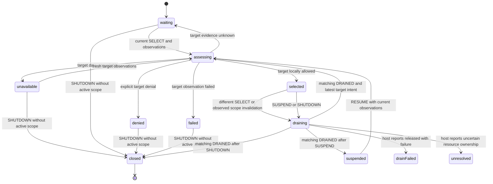

# Workspace lifecycle: selection, then private creation

Status: selection and Finance handoff are implemented; final pending-write and cold-start
qualification is in progress. Private creation, schema/catalog changes, invitations and generic data
operations are outside this slice. Baselines: library main `9372e0a` (PR #4), Finance main `f83be67`
(PR #39). Both feature branches: `plan/workspace-lifecycle`.

## Scope and delivery order

Shared recovery, restoration, startup acquisition, and acquired-session readiness are merged and
adopted in Finance. The next capability is workspace scope. Deliver selection/switching first,
then private creation, then reusable presentation. These are independent review cycles, not one
large workspace extraction. Invitations/membership administration and generic data operations follow.

The first implementation is a generic selection statechart with typed host observations and a
scoped drain protocol. It neither creates workspaces nor navigates. Prove incremental adoption at
Finance's existing workspace coordinator before stabilizing the interface. Private creation needs
its own transaction/reconciliation design and review after the selection boundary is proven.

## Evidence and ownership boundaries

Finance main sources:

- `machines/runtime/readiness.ts` coordinates session facts, initialization, workspace navigation,
  integrity, creation, and bank actors. Its existing application/workspace tree owns resource drain.
- `machines/workspaces/workspace-navigation.ts` mixes selection with URL composition, global routes,
  directory redirects, and legacy transaction-to-organization lookup. Routes and that domain lookup
  remain Finance-owned; they do not define a foundation router.
- `workspace-initialization.ts` distinguishes local discovery, profile provenance, and authoritative
  discovery. Missing local profiles/workspaces do not authorize bootstrap. Its remote discovery can
  wait when authority does not answer; do not spread that wait into already usable local selection.
- `workspace-creation-operation.ts`, `workspace-creation-journal.ts`, reconciliation, persistence, and
  `workspace-creation-transaction.ts` retain operation identity and explicit uncertain-write outcomes.
  Creation is not one opaque promise. The transaction reads/checks, stages, commits, settles locally,
  and rolls back where possible. Those meaningful stages must remain visible after any extraction.
- Finance creation writes organizations, owner membership, profiles/provenance, and starter categories;
  it uses account-access modes, default currency, and deterministic category IDs. Those schemas,
  policy details, financial records, and journals stay Finance-owned in the first adoption.

No Finance schema/data migration is proposed. A later new app can use app-owned Jazz-native workspace
and membership schemas through named integration modules. The library must not import Finance schema,
Organization, profile IDs, route names, currencies, category factories, or bank dependencies.

## Selection facts and public protocol (provisional)

The host integration binds one acquired session/client identity with a fresh opaque binding token.
It owns Jazz subscriptions and supplies actor-free observations. A view receives workspace summaries
and selected public state/callbacks, never SDK handles or private actor context.

Facts distinguish:

- Directory availability: loading, locally available entries (including zero), unavailable, or failed.
  Availability does not establish global completeness. An empty list does not establish revoked access.
- Requested workspace identity, independent of directory enumeration and URL location.
- Access to that specific target: locally allowed, explicitly denied, unknown, or failed. Missing
  local membership is unknown unless the integration has explicit evidence for denial. A directory
  row or a route parameter alone does not grant access.
- A host scope revision for identity/client binding and an observation generation. A → B → A must
  not accept old A reports. Access-loss and session-invalidating observations immediately invalidate
  the current published scope before waiting for cleanup.

Proposed commands:

- BIND initializes a fixed identity/client attachment without SDK effects. Replacement requires
  old-attachment shutdown/drain and a fresh binding; no global registry or second session owner.
- OBSERVED supplies the current correlated directory/target-access facts. The integration publishes
  changes whenever observed membership/session/client facts invalidate the prior decision.
- SELECT supplies explicit workspace intent and a fresh selection attempt. The host also uses it to
  translate an initial route or an explicitly chosen default. The library does not auto-pick the
  first directory entry or infer first use from a single/empty list.
- DRAINED acknowledges the exact binding, old scope epoch, and transition request. Only the existing
  host resource coordinator sends it, after its domain work has actually drained. A separate DRAIN_FAILED report carries a finite
  released-with-failure or unresolved category; it must never masquerade as a clean acknowledgement.
- SUSPEND invalidates selection for host-coordinated session retry/restoration and drains the current
  scope. RESUME requires fresh correlated observations; it cannot revive a cached grant by itself.
- SHUTDOWN invalidates the current scope and completes only after any requested host drain.

Reports: SCOPE_INVALIDATED, WORKSPACE_DRAIN_REQUESTED, and selected/waiting/denied/unavailable/failed
outcomes, all scoped to binding, attachment, and attempt/epoch. Invocation output distinguishes closed after released resources from unresolved host-drain failure. Exact
names/types are implementation proposals; no export is stable yet. Navigation success/failure is
reported by the host's separate router workflow and never repeats creation or selection mutation.

## Selection statechart and resource ownership

The host remains the sole owner of workspace/domain resource cleanup. The selection actor invalidates
its decision and requests that drain; it does not stop workspace, bank, transaction, or subscription
actors behind the host's back. The host must never await selection shutdown before servicing its
outstanding drain request. New scope readiness publishes only after the old scope has drained and
current target access is locally allowed. Closing supersedes pending selections and resume commands.

While draining, retain only the latest explicit selection intent; late old-epoch observations cannot
reattach the old scope. A return to the same workspace still requires the new epoch. Unknown target
facts wait without creating, repairing, navigating, or declaring denial. A lost observer invalidates
selection and reports failure; callback errors are bridged explicitly by the integration.

An already failed/completed host resource owner must not be awaited for an impossible acknowledgement:
the supervisor reports the actual released/uncertain drain result. Released-with-failure enters
drainFailed, keeps the old scope invalid, and requires explicit host-authorized retry with current
facts before assessing another selection. Shutdown there can close because release is established.
Unresolved ownership enters a terminal unresolved outcome with correlation to the failed drain;
it never publishes a replacement scope or claims cleanup succeeded. The application supervisor owns
that failure/recovery record and must not automatically restart selection or replay uncertain writes.
This outcome is distinct from closed, including when shutdown was requested. Actor stopping alone
does not certify cancellation.

## First Finance adoption seam

Host the shared selection attachment under Finance's existing application coordinator, above the
workspace tree it must drain; the workspace coordinator consumes the shared verdict. The integration keeps
its existing directory/membership queries and maps observed facts; Finance still owns initialization,
bank/transfer cleanup, integrity, schema access, URLs, transaction route resolution, and navigation.
Replace the selected-scope decision only, not the entire workspace tree. Inventory the existing
navigation/access guards first so one decision has one owner; do not leave duplicate active policies.

Before runtime work, document the exact request/acknowledgement path between selection and the current
workspace/application owners. Preserve already approved local readiness and online-only administration
rules. The public protocol must permit an app without banks, profiles, or a router to use the same
selection machine. A small synthetic consumer plus focused Finance adoption is the qualification.

## Subsequent private creation boundary

Private creation is explicit user intent and can be valid even for a recovered identity; automatic
first-workspace creation additionally requires trustworthy new-identity provenance. Current startup
acquisition/status reports do not provide that provenance. Until it is designed and evidenced, the
library offers explicit creation and never bootstraps from absence. Finance keeps its existing
initialization policy during selection adoption.

The later design must specify these state-owned steps before implementation:

1. Validate the requested name using an approved shared rule; establish one operation identity and
   stable workspace/membership IDs before issuing writes. Preserve that identity across retry/recovery.
2. Record recovery information before commit where the chosen durability contract requires it.
   Define the journal boundary and failure handling; do not assume Finance's localStorage format is
   a generic library contract or that its existence proves a database write persisted.
3. Acquire one supported transaction resource; read necessary records; make guarded eligibility and
   conflict decisions; stage the private workspace/owner membership atomically under actual policies.
4. Commit and await the required local persistence. Keep global acceptance independent. Classify
   failed-before-commit, locally persisted, rejected, cancelled, and unknown settlement honestly.
5. On interruption, retain acquired resources and issued commit/settlement until their outcomes are
   known; roll back only when supported and still applicable. A committed workspace is not undone by
   closing its dialog. Reconcile unknown outcomes with the same IDs before any retry.

Backend-specific schemas/policies remain integration-owned. A generic transaction workflow can consume
leaf resource operations, or a reviewed backend statechart can implement the resource protocol.
Neither option may conceal Finance's entire read/check/write/journal/reconcile workflow inside a
createWorkspace(): Promise wrapper. Review the exact installed Jazz transaction API and storage-level
private-access tests before choosing the resource contract. Do not infer capability from method names.

Keep Finance starter data out of generic readiness. Its required financial records must still be
created under its approved invariant/atomicity rules: do not split its existing transaction merely
to claim extraction. If generic creation cannot preserve those rules, Finance adopts selection first
and retains its native creation workflow until a separate compatible design is reviewed.

Creation success does not select or navigate implicitly. The host may explicitly select the returned
workspace through the same drain/access protocol; navigation-only retry must not create another one.
Naming, DUI creation/selection views, localization, invitations, membership administration, and private
policy qualification have their own focused reviews. No new strings or visual design are proposed now.

## Verification and review gates

This design follows the constitution's Jazz-only boundary, machine-first workflow, singular ownership,
and incremental adoption requirements. No new backend, universal schema language, or whole-Finance
migration is required. The first implementation review is selection contracts and workflow only.
Do not implement private creation as part of that batch. Review implementation before tests, then
qualify its public package entries and separately review the focused Finance adoption.

Affected verification to identify before implementation:

- Selection states with real actors: waiting/allowed/denied/unavailable/error; partially populated and
  empty directories; explicit selection independent of enumeration; scope replacement; A → B → A;
  stale observations/acks; rapid selection; suspend/resume; observer failure; cancellation/shutdown;
  host drain failure and uncertain writes; no implicit create/navigation or host SDK disposal.
- Finance workspace readiness/navigation/startup unit fixtures and `multiple-workspaces`, workspace
  selection/rename, authentication restoration, scoped transaction navigation, and cold/offline cases.
  Inspect current test/route helpers before execution, including inherited workspace query parameters.
- Creation later: transaction resource cleanup, atomic workspace/member visibility, journal failure,
  cold restart after local persistence, uncertain commit reconciliation, two-device same-ID recovery,
  and unrelated identity denial at the storage boundary. Stub-only tests cannot qualify private access.

No implementation tests, servers, dependency installs, or user data operations were performed for this
planning change. Formatting and static document/link checks do not establish runtime correctness.

## Initial selection implementation review

The runtime batch is three files: actor-free `contracts/workspace-selection.ts`, the pure
`machines/workspaces/selection.ts` statechart, and package exports. Entry points are
`workspace/contracts` and `workspace/workflow`; the latter exports createWorkspaceSelectionMachine(),
WorkspaceSelectionInput, and selectWorkspaceLease(). No root barrel, Jazz adapter, provider,
subscription, route, UI, or dependency change is required for this observation-driven workflow.

BIND fixes one identity/client attachment. SELECT takes a nonempty workspace ID and a positive safe
integer attempt strictly newer than the preceding selection. OBSERVED carries that exact request,
scope, and a nonnegative observation generation increasing within the attempt. Binding, attachment,
attempt, workspace, and generation checks reject stale facts. Directory data is informational and
comes with target observations; the host still owns independent directory subscriptions and chooser
rendering before a target exists. Neither directory loading nor an empty list blocks explicitly
allowed local target access. The actor never infers denial, completeness, or first use from a list.

Each published selected lease has its own increasing epoch. A fresh SELECT, suspension, or observed
loss/uncertainty/failure invalidates that lease and creates one opaque drain token. Switching,
suspending, and closing are nested phases under the same drain lifetime. Rapid selection retains the
latest explicit intent without replacing the outstanding drain token. Only a matching token, old
lease epoch/request, and fixed binding can acknowledge release. No successor lease publishes before
release plus current allowed facts. Repeated observations that remain allowed update public facts
without issuing another lease epoch or remounting resources.

Suspended and drainFailed may receive newer facts without becoming selected. RESUME and RETRY,
respectively, require an explicitly supplied observation newer than the latest retained generation;
they cannot reuse a pre-suspend grant or bypass a failed drain by ordinary SELECT/OBSERVED. Host
integration must read current facts and advance its observation generation for those commands. A new
selection attempt resets that attempt's observation sequence; old attempts remain invalid forever.

DRAIN_FAILED distinguishes released and unresolved. Released-with-failure requires explicit retry;
shutdown can complete because release is known. Unresolved completes with output containing the
failed drain identity, without a ready replacement or a false clean shutdown. The host supervisor
retains recovery responsibility and must not auto-replay uncertain work. During closing, later
selection, observation, suspension, and duplicate shutdown commands cannot reverse shutdown priority.
Closed clears scope, request, observation, lease, and drain references. Unresolved retains only the
binding/drain correlation needed for its failure result, not SDK resources or application records.

Recursive machine-first audit: all selection/access classification, lease epochs, invalidation,
latest-intent retention, drain correlation, suspension/retry, shutdown priority, and terminal outcomes
are statechart guards/transitions/actions. Context stores facts, counters, and issued lease/drain
identities; there are no lifecycle booleans. Helpers only narrow required protocol fields or compare
identity. There are no async helpers, promise/callback actors, child invocations, SDK calls, or hidden
transaction orchestration. Host resources never move into this actor. Existing session/recovery
workflows and Finance remain unchanged.

Full library source types pass with zero Svelte errors/warnings. Focused lint/format and diff checks
pass. Package build and strict publint pass. No unit/browser tests or new
consumer fixtures have been created/run. After review, the coverage cycle must exercise real actors
and report ordering, clean/released-failure/unresolved drain outcomes, latest intent while draining,
shutdown priority, stale A → B → A facts/acks, suspension/resume freshness, directory independence,
lease selection, and public built-package imports. These static checks do not establish those runtime
properties or storage-level authorization.

## Approved selection verification

The user approved the selection implementation before this coverage cycle. All 33 real-actor tests
pass. They cover unbound shutdown; all target access outcomes; directory loading/failure/empty/partial
lists independently of allowed target access; invalid/foreign intent and observation scopes; stale
attempts/generations; allowed updates preserving one lease; invalidation-before-drain ordering;
latest intent during a retained drain; A → B → A; foreign token/binding/attachment/epoch/request
acknowledgements; synchronous host drain replies; suspend/resume freshness; rapid selection while
suspending; duplicate commands; shutdown priority from switching/suspending/closing; explicit retry
after released failure; honest closed and unresolved outputs. No production correction was needed.

The built-package consumer resolves workspace contracts/workflow declarations, then exercises
selection → invalidation → drain acknowledgement → replacement selection → shutdown through those
public entries. It uses no backend/provider/Finance import and an empty directory with explicitly
allowed target facts. NodeNext declaration checks, Node runtime imports, and the Vite consumer build
pass. Full source types report zero Svelte errors/warnings; focused lint/format, package build,
strict publint, and diff checks pass.

These checks qualify the synthetic selection protocol only. They do not prove real subscription
binding, Finance resource-drain integration, Jazz authorization, or storage durability. No Finance
file, browser server, dependency version, archive, catalog, schema, or user data changed in this cycle.
The implementation and coverage are committed as `390902e`. The Finance mapping is now documented
in its `docs/local-first-workspace-selection-plan.md` on `plan/workspace-lifecycle`.
Private creation remains a separate later design.

## Finance adoption mapping

Finance's application root, rather than its workspace subtree, supervises selection so the selection
actor can survive the resources it asks to drain. A fixed-bound library actor needs a Finance-owned
attachment lifetime for client/identity replacement. Finance has implemented and verified that
attachment plus scoped transfer drain, and refreshed its vendored library archive. Application
selection wiring is now integrated and verified in Finance's working branch.

Ordinary selection changes must preserve identity-bound startup, creation, and route navigation.
Whole workspace closure shuts down creation. WORKSPACE_CLOSED is a terminal-entry notice, not finite
completion proof; the application waits for the coordinator's actual correlated onDone output for
identity/session replacement and application shutdown. The
selected-resource lifetime covers bank (including retention) and integrity. Its finite result and the
application transfer owner's exact scoped acknowledgement must both match the issued drain before
DRAINED. Finance now exposes finite released/releasedWithFailure/unresolved outputs from bank,
retention, and integrity, preserving earlier uncertainty across later success. Finance also has a
reviewed and verified selected-resource owner for bank and integrity, with both completion orders
and failure/late-message coverage. The production coordinator migration now uses this selected-resource owner while preserving
startup/creation/navigation. That migration is reviewed and verified with 246 focused unit cases,
12 focused browser scenarios, and clean type/format checks. It also preserves drafts on equivalent
editing observations and rejects late integrity forwarding after drain begins.
Shared selection and application transfer-drain correlation are now integrated. The coordinator
consumes library leases; directory availability does not gate exact local membership or ordinary
transfer usability. Transfer requests capture original scope before submission, with an application-
lifetime generation across attachment replacement. A finite join waits for selected-resource and
transfer evidence before the application acknowledges the exact library drain. Already-completed
owners contribute their actual finite evidence at join creation, avoiding messages to a completed
join. Unknown cleanup cannot authorize another SDK identity change or clean shutdown.

The handoff is verified with 191 distinct focused Finance unit cases and a final passing 16-scenario
browser run covering recovery/sign-in, bank cancellation/retention, selector/filter/revocation,
creation through a selection change, readiness/reload, offline and cross-currency transfer creation,
and transfer link/unlink/delete. Source/service-worker and browser-test types and formatting pass;
the final server log contains no stopped-actor warnings. Finance changes remain uncommitted.
This qualification does not claim a new cold-restart/nonanswering-remote or full PWA suite.

Independent route-local actor teardown remains an explicit qualification limit, not an implicit
guarantee of that acknowledgement. The detailed Finance design and verification notes live in
`docs/local-first-workspace-selection-plan.md`; they separate reviewed prerequisites from the later
application/observation adoption. No Finance domain behavior or resource ownership moves into the
shared library as part of this mapping.
